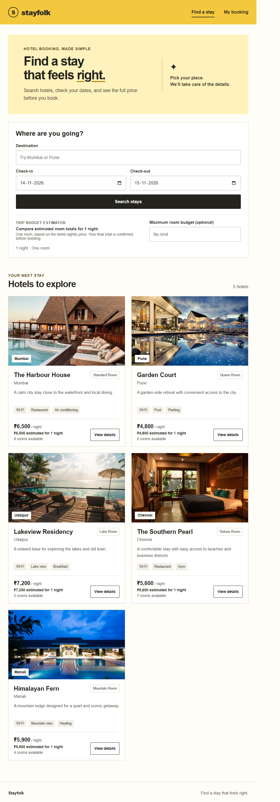

# Hotel Booking Portal

A hotel-booking project with a Java 17 / Spring Boot REST API, MySQL persistence, and a
React + Vite frontend.

The frontend lets guests search hotels, check availability, view a price quote, create a
booking, retrieve it by reference and email, and cancel it.
Hotel cards open a dedicated details page that requests the latest room availability for the
selected dates.

## Requirements

- JDK 17 (set as the Project SDK in IntelliJ IDEA)
- IntelliJ IDEA
- MySQL 8 or later
- Node.js and npm for the frontend

## 1. Create the MySQL database

Start MySQL, then open Command Prompt and connect:

```bat
mysql -u root -p
```

Enter your MySQL password, then run:

```sql
CREATE DATABASE hotel_booking_db;
EXIT;
```

If the `mysql` command is not recognized, start MySQL and create the database using MySQL
Workbench instead.

## 2. Configure backend environment variables

The backend reads local settings from `backend\.env`. This file is ignored by Git so your
local database password is not committed. For a fresh clone, create it from the example in
Command Prompt at the repository root:

```bat
copy backend\.env.example backend\.env
```

Open `backend\.env` and replace `change_this_to_your_mysql_password` with your MySQL
password. Change `DB_USERNAME` too if your MySQL user is not `root`. The file contains:

```dotenv
DB_URL=jdbc:mysql://localhost:3306/hotel_booking_db
DB_USERNAME=root
DB_PASSWORD=your_mysql_password
DDL_AUTO=update
FRONTEND_ORIGIN=http://localhost:5173
```

Keep `backend\.env` local. Commit changes to `backend\.env.example` only when changing the
names or adding non-secret configuration values; never put a real password in the example.
The backend does not supply a default database password; configure `DB_PASSWORD` before
starting it.

## 3. Run the backend in IntelliJ IDEA

1. In IntelliJ, choose **File > Open** and open the repository root folder
   (`Hotel-Booking-Portal`).
2. Set **Project SDK** to JDK 17 in **File > Project Structure > Project**.
3. Open `backend\pom.xml` as a Maven project and allow IntelliJ to import it.
4. Open
   `backend\src\main\java\com\hotelbookingportal\BackendApplication.java` and run
   `BackendApplication`.
5. In **Run > Edit Configurations**, set **Working directory** to the repository root. Spring
   Boot loads `backend\.env` from there; no IntelliJ EnvFile plugin or manually entered
   environment variables are needed.
6. The API starts at `http://localhost:8080`. On first startup, five sample hotels and their
   room types are inserted if the hotels table is empty.

You can also run the backend from **Command Prompt** at the repository root. The same
`backend\.env` file is loaded automatically:

```bat
backend\mvnw.cmd -f backend\pom.xml spring-boot:run
```

Tests use an in-memory H2 database, so they do not need MySQL:

```bat
backend\mvnw.cmd -f backend\pom.xml test
```

## 4. Run the frontend

The frontend is a separate Node.js app. Open a second Command Prompt at the repository root:

```bat
cd frontend
copy .env.example .env
npm install
npm run dev
```

`frontend\.env` sets `VITE_API_BASE_URL` to `http://localhost:8080/api`. The UI uses that
default if the file is not present. Open the local address printed by Vite (usually
`http://localhost:5173`). Make sure the backend is running first.

## Backend API

All dates use `YYYY-MM-DD`. A stay includes check-in and excludes check-out.

| Method | Endpoint | Purpose |
| --- | --- | --- |
| `GET` | `/api/hotels?location=Mumbai` | Browse hotels and optionally search by location |
| `GET` | `/api/hotels?location=Mumbai&checkIn=YYYY-MM-DD&checkOut=YYYY-MM-DD` | Search hotels and include room availability |
| `GET` | `/api/hotels/{hotelId}?checkIn=YYYY-MM-DD&checkOut=YYYY-MM-DD` | View hotel details and room availability |
| `POST` | `/api/bookings/quote` | Get a server-calculated price quote and current availability |
| `POST` | `/api/bookings` | Book one room |
| `GET` | `/api/bookings/{reference}?email=guest@example.com` | Retrieve a booking using its reference and email |
| `DELETE` | `/api/bookings/{reference}?email=guest@example.com` | Cancel a booking |

Quote request:

```json
{
  "roomTypeId": 1,
  "checkIn": "2030-12-10",
  "checkOut": "2030-12-12"
}
```

Booking request:

```json
{
  "roomTypeId": 1,
  "customerName": "Asha Rao",
  "email": "asha@example.com",
  "checkIn": "2030-12-10",
  "checkOut": "2030-12-12"
}
```

Use dates that are today or later when trying the API. Booking amounts are calculated by the
backend from the room price and number of nights. Invalid dates and unavailable inventory
return an error response with a message.

## Booking assumptions and surprise feature

- Each booking reserves one room.
- Check-in is inclusive and check-out is exclusive. A guest checking out on a date does not
  overlap a guest checking in on that same date.
- For a multi-night stay, availability is based on the peak number of overlapping confirmed
  reservations on any night in the stay.
- Booking creation locks the room type and checks availability inside a database transaction,
  preventing concurrent requests from booking beyond the available capacity.
- Cancelling a confirmed booking releases the room. Lookup and cancellation both require the
  booking reference and matching email.
- The Trip Budget Estimator compares one-room stay totals for the selected dates and can filter
  out hotels above an optional budget. Estimates use the listed nightly price; the backend quote
  remains the final price before booking.

## Design and screenshots

See [DESIGN.md](./DESIGN.md) for the application structure, data model, booking flow, and UI
design notes. Project screenshots are in [`docs/screenshots/`](./docs/screenshots/).



Additional captures: [hotel details](./docs/screenshots/02-hotel-details.png),
[booking confirmation](./docs/screenshots/03-booking-confirmation.png),
[manage booking](./docs/screenshots/04-manage-booking.png),
[cancelled booking](./docs/screenshots/05-cancelled-booking.png),
[budget estimator](./docs/screenshots/06-budget-estimator.png), and
[mobile layout](./docs/screenshots/07-mobile-layout.png).

## AI assistance

GitHub Copilot was used to help implement and document this project. The project author should
review the final code. The project author reports spending **8 hours** on the project.

## Current limitations

- Hotel photos are loaded from Unsplash URLs and require an internet connection.
- The displayed budget estimate is for one room only; the server-generated booking quote is
  authoritative.
